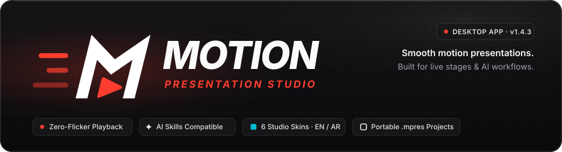
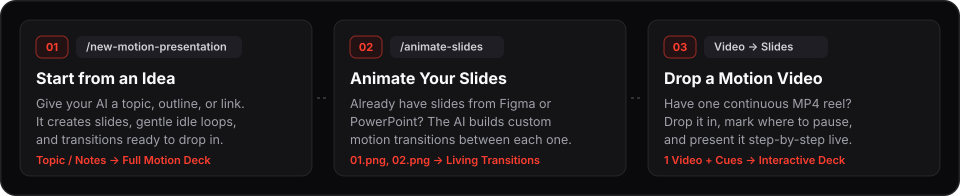
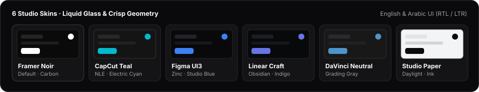

<p align="center">
  
</p>

<p align="center">
  <a href="https://github.com/Mohamed-Sukar/Motion-Presentation/releases">
    
  </a>
  
  
  
  <a href="./LICENSE">
    
  </a>
</p>

<p align="center">
  <strong>Present motion graphics as effortlessly as PowerPoint slides — with zero black flashes, living slide loops, and built-in AI workflows.</strong>
</p>

<p align="center">
  <a href="#get-started-in-30-seconds">Download &amp; Try Demo</a>
  &nbsp;&middot;&nbsp;
  <a href="#three-simple-ways-to-build">How It Works</a>
  &nbsp;&middot;&nbsp;
  <a href="#built-for-ai-tools--skills">For AI &amp; Skills Users</a>
  &nbsp;&middot;&nbsp;
  <a href="#live-presenter-controls">Presenter Controls</a>
</p>

---

##  Why Motion Presentation Studio?

Traditional slide tools (like PowerPoint or Keynote) often flash a black frame or stutter whenever you mix still slides with transition videos. Normal video players (like VLC) play smoothly, but they don't pause cleanly per slide, let you jump between slides, or play backwards on a clicker press.

**Motion Presentation Studio** gives you both in one desktop app:

| Experience | Traditional Slide Apps | Video Players | Motion Presentation Studio |
| :--- | :--- | :--- | :--- |
|  **Slide-to-video transitions** | Black flash or lag | No slide stops | **Zero-flicker, instant response** |
|  **Living slide backgrounds** | Stutters on loop | Plays straight through | **Seamless Idle Loops while you speak** |
|  **Stepping backward** | Cuts abruptly | Slow seeking | **True reverse video playback** |
|  **AI presentation workflows** | Not supported | Not supported | **Native AI Skills + 1-click edit prompts** |
|  **Stage &amp; audience tools** | Basic | None | **Laser, Black/Whiteout, Notes, Dual Screen** |

---

##  Three Simple Ways to Build

<p align="center">
  
</p>

1. **Create a whole presentation with AI (`/new-motion-presentation`)**
   Give your AI assistant a topic, rough notes, or a product link. It drafts the slide plan, lets you pick a visual direction, renders crisp slides, subtle looping animations (**Idle Loops**), and smooth transitions — then outputs a folder you simply drop into the app.
2. **Bring your existing slides to life (`/animate-slides`)**
   Already designed your deck in Figma, PowerPoint, or Canva? Export your slides as numbered images (`01.png`, `02.png`, ...), point your AI tool to them, and it generates smooth motion transitions between every slide while keeping your original designs intact.
3. **Turn any single video into an interactive deck (`Video -> Slides`)**
   Already have one continuous motion video (from an AI video generator or video editor)? Drop the video in, mark the exact moments where you want to pause and talk, and present it slide-by-slide with your clicker.

---

##  Built for AI Tools &amp; Skills

If you use AI assistants that support **Agent Skills** (such as Antigravity, Claude Code, Codex, Cursor, or Gemini CLI), this repository includes two ready-to-use skills inside [`.agents/skills/`](.agents/skills/):

| Skill | Best For | What You Give the AI | What You Get Back |
| :--- | :--- | :--- | :--- |
| **`/new-motion-presentation`** | Starting from scratch | A topic, script, notes, or URL | Full deck with `presentation.json`, slides, idle loops, and transitions |
| **`/animate-slides`** | Upgrading finished slides | A folder of numbered images (`01.png`, `02.png`, ...) | Smooth motion transition clips tailored to each slide pair |

###  Fix One Slide Without Redoing the Whole Deck

Most AI workflows force you to regenerate everything when you only want to tweak one headline or speed up one transition.

Inside Motion Presentation Studio, select any slide or transition, type what you want to change in plain language (for example: *"make this transition snappier"* or *"add a gentle idle loop"*), and copy the **Surgical AI Edit Prompt**. Paste it back into your AI tool — it updates **only that slide or transition** and keeps the rest of your deck untouched.

---

##  Made for Live Stages &amp; Presenters

Everything you expect when presenting in front of an audience works out of the box:

-  **Clicker &amp; Keyboard Friendly:** Works seamlessly with wireless presentation clickers, arrows, and `Space`.
-  **External Display Console:** Present full-screen on a projector or TV while controlling slides and reading notes from your laptop screen.
-  **Built-In Stage Tools:** Toggle a **Laser Pointer** (`Ctrl + L`), **Blackout** (`B`) or **Whiteout** (`W`) screen to focus attention on you, **Speaker Notes** (`S`) with a presentation timer (`T`), and a **Quick Slide Grid** (`G`) to jump anywhere.
-  **Portable `.mpres` Files:** Save your entire deck — images, videos, loops, cue points, and notes — into one `.mpres` file you can double-click to open on Windows.
-  **Last-Frame Extraction:** Need a still slide right after a transition video ends? Extract the final frame in one click so it matches seamlessly.

---

##  Crafted Studio Interface &amp; 6 Skins

Motion Presentation Studio uses a distraction-free **Liquid Glass** interface with crisp geometry, comfortable contrast for dark rooms or daylight prep, and full **English &amp; Arabic (`EN / AR`)** switching.

<p align="center">
  
</p>

---

##  Live Presenter Controls

| Key / Action | What It Does |
| :--- | :--- |
| `Space` / `→` / `Enter` / `N` | Next slide (plays transition) |
| `←` / `Backspace` / `P` | Previous slide (smooth reverse transition) |
| `Ctrl + L` | Toggle Laser Pointer |
| `B` / `W` | Blackout (`B`) or Whiteout (`W`) screen |
| `S` | Show or hide Speaker Notes |
| `T` | Reset presentation timer |
| `G` | Open Quick Slide Grid |
| `0–9` + `Enter` | Jump directly to a slide number |
| `F5` / `Esc` | Start or exit Fullscreen Presenter |
| `Ctrl + K` | Open Command Palette (quick actions &amp; skins) |

---

##  Get Started in 30 Seconds

1. **Download the Windows Installer** from the [Releases page](https://github.com/Mohamed-Sukar/Motion-Presentation/releases) and run Setup.
2. **Try it immediately — no files needed:** Open the app and click **Load Demo** to test a live motion presentation with real transitions and presenter tools.
3. **Or use your AI tool:** Copy [`.agents/skills/`](.agents/skills/) into your workspace (or open this folder in your AI tool), run `/new-motion-presentation` or `/animate-slides`, and drag the generated folder straight onto the app window.

---

<details>
<summary> <strong>For Developers: Run or Build from Source</strong></summary>

Requires **Node.js 18+** on Windows.

```bash
# Install dependencies
npm install

# Run the desktop app locally
npm run build && npm run electron:dev

# Run tests and type checks
npm test
```

</details>
